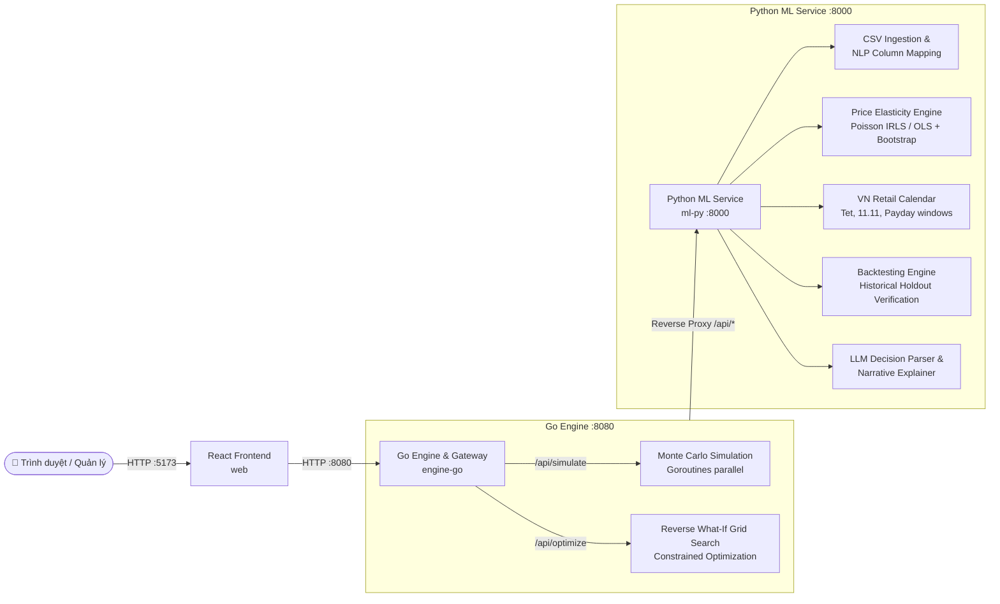

# What-If AI: Nền Tảng Mô Phỏng & Tối Ưu Hóa Quyết Định Kinh Doanh Bằng AI

> *"Mô phỏng trước khi quyết định — Hiểu rõ trước khi hành động."*

[](https://www.python.org/)
[](https://fastapi.tiangolo.com/)
[](https://go.dev/)
[](https://react.dev/)
[](LICENSE)
[]()
[]()

---

## 1. Tổng quan & Tuyên ngôn giá trị (Executive Summary)

Trong vận hành kinh doanh bán lẻ và thương mại điện tử, các nhà quản lý đối mặt hàng ngày với các quyết định mang tính sống còn:
* *Có nên tăng hoặc giảm giá sản phẩm để cải thiện biên lợi nhuận?*
* *Nếu nhu cầu thị trường co giãn mạnh hơn dự kiến, kịch bản xấu nhất là gì?*
* *Mức giá hoặc chương trình khuyến mãi nào giúp đạt tăng trưởng mục tiêu trong khi không bị vỡ ngân sách nhập hàng và vượt quá sức chứa tồn kho?*

Hầu hết các giải pháp hiện nay (báo cáo BI truyền thống, bảng tính Excel hoặc Dashboard) chỉ đóng vai trò **"gương chiếu hậu" (Hindsight)** — phản ánh những gì đã xảy ra trong quá khứ. Ngược lại, các công cụ Chatbot AI thông thường thường tự tạo ra (hallucinate) các con số tài chính mà không có cơ sở kinh tế lượng.

**What-If AI** giải quyết bài toán này bằng kiến trúc 3 tầng phân tách trách nhiệm chặt chẽ:
1. **Phân tích dữ liệu & Kinh tế lượng (Econometrics - `ml-py`)**: Ước lượng phân phối độ co giãn của cầu theo giá (Price Elasticity of Demand) kèm khoảng tin cậy bootstrap và kiểm soát lịch lễ Tết/sự kiện Việt Nam (`vn_calendar`).
2. **Mô phỏng xác suất & Tối ưu hóa song song (Monte Carlo & Optimization - `engine-go`)**: Động cơ Go hiệu năng cao chạy 10.000 lượt mô phỏng kịch bản và thuật toán quét lưới tối ưu hóa ngược (**Reverse What-If**).
3. **Trợ lý AI & Giao diện tương tác (`web`)**: Giao diện React hiển thị trực quan dải phân phối xác suất ($p_5, p_{50}, p_{95}$), độ co giãn hòa vốn, và bắt buộc **gán nhãn nguồn dữ liệu** (`SYNTHETIC | PUBLIC_M5 | YOUR DATA`).

---

## 2. Điểm khác biệt & Lợi thế cạnh tranh

| Tiêu chí | Báo cáo BI / Excel truyền thống | Chatbot AI thông thường | What-If AI |
| :--- | :--- | :--- | :--- |
| **Góc nhìn phân tích** | Quá khứ (*Đã bán được bao nhiêu?*) | Tóm tắt văn bản tổng quát | Tương lai & Kịch bản phản thực (*Nếu đổi giá thì sao?*) |
| **Bản chất tính toán** | Thống kê mô tả (Descriptive) | Tự sinh văn bản (Dễ bịa số liệu) | **Toán học & Kinh tế lượng xác định (Zero LLM Math)** |
| **Đánh giá rủi ro** | Dự báo 1 con số đơn lẻ (Point estimate) | Định tính, chung chung | **Phân phối xác suất Monte Carlo (p5 - p50 - p95)** |
| **Độ nhạy giá** | Giả định cứng nhắc | Không phân tích được | **Ước lượng độ co giãn kèm phân phối bootstrap & Lịch VN** |
| **Chiều ra quyết định** | Thủ công thử từng kịch bản | Chỉ trả lời câu hỏi trực tiếp | **Reverse What-If**: Đi từ mục tiêu tìm hành động tối ưu |
| **Kiểm soát giả định** | Bị ẩn trong công thức phức tạp | "Hộp đen" hoàn toàn | **Bảng giả định tương tác (Glass-box AI)** |
| **Minh bạch dữ liệu** | Không phân định | Dễ ngộ nhận | **Bắt buộc dán nhãn nguồn dữ liệu (`SYNTHETIC`, `PUBLIC_M5`, `USER`)** |

---

## 3. Kiến trúc hệ thống 3 Tầng (3-Tier Architecture)

Hệ thống tuân thủ hợp đồng API nghiêm ngặt được định nghĩa trong `docs/ARCHITECTURE.md` và các schema trong `contracts/`:



---

## 4. Các tính năng cốt lõi (Core Features)

### 4.1. Tự động ánh xạ cột thông minh (NLP Column Mapping)
* Doanh nghiệp tải lên bất kỳ file CSV bán hàng nào mà không cần sửa đổi định dạng thủ công.
* Tự động nhận diện và ánh xạ các cột: ngày bán, mã sản phẩm, giá bán, giá vốn, sản lượng, cờ khuyến mãi, tồn kho bằng quy tắc kết hợp mô hình NLP semantic embedding.
* Luôn hiển thị giao diện xác nhận (Mapping Screen) để người dùng kiểm tra trước khi cam kết.

### 4.2. Ước lượng độ co giãn kèm khoảng tin cậy & Lịch Việt Nam
* Mô hình hóa hàm cầu kinh tế lượng:
  $$\ln(Q) = \beta_0 + \beta_1 \ln(P) + \beta_2 \cdot \text{Promo} + \beta_3 \cdot \text{Weekend} + \sum \gamma_k \cdot \text{Event\_Window}_k + \varepsilon$$
* Tích hợp bộ lịch bán lẻ Việt Nam (`vn_calendar`): kiểm soát độ biến động giá vào các dịp Tết Nguyên Đán, siêu sale 9.9, 10.10, 11.11, 12.12, Black Friday, và kỳ nhận lương.
* Sử dụng kỹ thuật **Bootstrap Resampling** ($N \ge 300$) để ước lượng toàn bộ phân phối của hệ số co giãn $\beta_1$, loại bỏ rủi ro khi chỉ dựa vào một con số ước lượng điểm.

### 4.3. Mô phỏng 4 Kịch bản định lượng & Monte Carlo (10.000 lượt)
* **Cơ sở (Baseline)**: Chuẩn hóa theo mức giá hiện tại.
* **Lạc quan (Optimistic)**: Khách hàng ít nhạy giá nhất (Phân vị 10% về độ nhạy cảm giá $|\varepsilon|$).
* **Kỳ vọng (Expected)**: Trung vị của phân phối độ co giãn.
* **Bi quan (Pessimistic)**: Khách hàng rất nhạy giá (Phân vị 90% về độ nhạy cảm giá $|\varepsilon|$).
* Chạy 10.000 lượt mô phỏng lấy mẫu đồng thời biến thiên độ co giãn và nhiễu nhu cầu thị trường ngẫu nhiên để xuất biểu đồ phân vị lợi nhuận ($p_5, p_{50}, p_{95}$) và xác suất vượt cơ sở $P(\text{Profit} > \text{Baseline})$.
* **Độ co giãn hòa vốn (Break-even Elasticity)**:
  $$\varepsilon^* = \frac{\ln\left(\frac{P_0 - C}{P_1 - C}\right)}{\ln\left(\frac{P_1}{P_0}\right)}$$
  Xác định chính xác ngưỡng phản ứng của khách hàng mà vượt qua đó, việc tăng giá sẽ gây suy giảm lợi nhuận.

### 4.4. Tối ưu hóa ngược — Reverse What-If (Core USP)
Thay vì thử mò mẫm từng mức giá, nhà quản trị chỉ cần đưa ra bài toán mục tiêu:
> *"Tìm phương án giúp tăng lợi nhuận tháng tới 15%, nhưng chi phí vốn lưu động không vượt quá 500 triệu VNĐ và kho còn 1.200 sản phẩm."*

Hệ thống tự động:
1. Quét lưới toàn bộ các mức điều chỉnh giá khả thi trong phạm vi an toàn.
2. Kiểm tra ràng buộc trần ngân sách ($Spend \le Budget$) và trần tồn kho khả dụng ($Q \le Stock$).
3. Xếp hạng Top các phương án có xác suất thành công cao nhất $P(Success)$.

---

## 5. Ví dụ minh họa tính toán (Concrete Case Study)

Xét sản phẩm thời trang mẫu **P01**:
* Giá bán hiện tại ($P_0$): **100.000 VNĐ** | Giá vốn ($C$): **60.000 VNĐ**
* Sản lượng cơ sở ($Q_0$): **10.000 sản phẩm/tháng**
* Doanh thu cơ sở: **1.000.000.000 VNĐ** | Lợi nhuận gộp cơ sở: **400.000.000 VNĐ**

Nhà quản lý đề xuất **tăng giá 10%** (lên **110.000 VNĐ**). Giả sử độ co giãn ước lượng trung tâm là $\varepsilon = -1.0$, dải bootstrap từ $-0.5$ đến $-2.0$:

| Kịch bản | Độ co giãn ($\varepsilon$) | Biến động SL ($\Delta Q$) | Sản lượng mới ($Q_1$) | Doanh thu mới | Lợi nhuận gộp mới | Biến động Lợi nhuận |
| :--- | :---: | :---: | :---: | :---: | :---: | :---: |
| **Cơ sở (Baseline)** | — | 0.0% | 10.000 | 1,000 tỷ VNĐ | 400 triệu VNĐ | 0% |
| **Lạc quan (p10 nhạy giá)** | $-0.5$ | $-4.7\%$ | 9.535 | 1,049 tỷ VNĐ | 477 triệu VNĐ | **+19.3%** |
| **Kỳ vọng (Trung vị)** | $-1.0$ | $-9.1\%$ | 9.091 | 1,000 tỷ VNĐ | 455 triệu VNĐ | **+13.8%** |
| **Bi quan (p90 nhạy giá)** | $-2.0$ | $-17.4\%$ | 8.264 | 909 triệu VNĐ | 413 triệu VNĐ | **+3.3%** |

> [!NOTE]
> Độ co giãn hòa vốn tính toán: $\varepsilon^* = -2.341$. Chỉ khi người tiêu dùng phản ứng nhạy giá hơn ngưỡng $-2.341$ (tương đương sản lượng sụt giảm hơn 20%), quyết định tăng giá mới bắt đầu gây thiệt hại cho lợi nhuận.

---

## 6. Cấu trúc mã nguồn chuẩn (Repository Layout)

```
Hackathon_AI_For_Business/
├── AGENTS.md                  # Quy tắc tối thượng cho AI Coding Agents (bắt buộc đọc đầu tiên)
├── Makefile                   # Điều phối toàn bộ hệ thống (make data, make test, make dev)
├── config/
│   └── fx.json                # Tỷ giá quy đổi ngoại tệ sang integer VND (USD: 25.000 VND)
├── contracts/                 # Hợp đồng chung (Shared Truth)
│   ├── fixtures/
│   │   └── elasticity_fixture.json   # Fixture kiểm thử chuẩn cho cả 3 tầng
│   ├── elasticity_fixture.schema.json
│   ├── simulate_request.schema.json
│   └── decision_spec.schema.json
├── data/
│   ├── synthetic/             # Bộ sinh dữ liệu v2 + các bộ dữ liệu kiểm định đã sinh
│   │   ├── make_synthetic_data_v2.py # Bộ sinh dữ liệu tích hợp Lịch Việt Nam
│   │   ├── check_elasticity_v2.py    # Kiểm tra độ thu hồi độ co giãn
│   │   ├── vn_calendar.py            # Lịch lễ Tết và sự kiện thương mại điện tử VN
│   │   └── out/                      # 8 bộ dữ liệu: fashion_shop_12, grocery_fmcg_15...
│   ├── public/                # Bộ nạp dữ liệu công khai (M5 Walmart, Dunnhumby)
│   │   └── README.md          # Hướng dẫn tải dữ liệu M5
│   └── raw/                   # Dữ liệu kinh doanh nội bộ (git-ignored)
├── docs/
│   ├── ARCHITECTURE.md        # Hợp đồng API chi tiết giữa Python, Go và React
│   ├── ROADMAP.md             # Lộ trình 9 Phase (P0 -> P8) cho 2 thành viên A & B
│   └── NLP_COLUMN_MAPPING.md  # Thiết kế tự động ánh xạ cột dữ liệu bằng NLP
├── phases/                    # Hướng dẫn chi tiết từng Phase (P0 -> P8)
│   ├── PHASE_0_foundation.md  # [Xong] Repo skeleton & frozen contracts
│   ├── PHASE_1_data_layer.md  # [Đang chạy] Synthetic v2 + M5 Loader + Lịch VN
│   └── ...
├── ml-py/                     # 🐍 Python ML Service (FastAPI :8000)
│   ├── pyproject.toml
│   ├── app/
│   │   ├── main.py            # FastAPI service liveness & routing
│   │   ├── data/              # calendar_vn.py, m5_loader.py, dunnhumby_loader.py
│   │   └── schemas/           # Pydantic v2 models
│   ├── scripts/               # export_schemas.py
│   └── tests/                 # Unit & integration tests
├── engine-go/                 # 🐹 Go Engine & API Gateway (:8080)
│   ├── go.mod
│   └── cmd/
│       └── engine/
│           └── main.go        # Reverse proxy & Monte Carlo simulation skeleton
└── web/                       # ⚛️ React + TypeScript + Vite (:5173)
    ├── package.json
    └── src/
        ├── App.tsx            # Dashboard chính
        └── components/
            └── DataSourceBadge.tsx # Badge nguồn dữ liệu bắt buộc
```

---

## 7. Lộ trình phát triển 9 Phase (Hackathon Roadmap)

| Phase | Tên Phase | Thành viên phụ trách | Trạng thái |
| :---: | :--- | :---: | :---: |
| **P0** | **Foundation & Contracts** (Repo skeleton, API health, contracts frozen) | **A + B** | ✅ **Hoàn thành** |
| **P1** | **Data Layer** (Synthetic v2, VN calendar, M5 loader, quy đổi VND) | **A** | 🚀 **Đang triển khai** |
| **P2** | **Ingestion & NLP Column Mapping** (Ánh xạ cột tự động) | **A** | ⏳ Tiếp theo |
| **P3** | **Elasticity Engine & Backtest** (Hồi quy Poisson/OLS + kiểm định quá khứ) | **A** | ⏳ Kế tiếp |
| **P4** | **Go Engine** (Mô phỏng Monte Carlo song song + Reverse What-If) | **B** | ⏳ Song song |
| **P5** | **React Frontend** (Giao diện người dùng Vite + Tailwind + Recharts) | **B** | ⏳ Song song |
| **P6** | **LLM Layer** (Phân tích câu hỏi tự nhiên & giải thích kết quả) | **A** | ⏳ Tiếp theo |
| **P7** | **Integration & Demo Freeze** (Tích hợp toàn diện & đóng băng demo) | **B leads, A** | ⏳ Trước 14:00 13/11 |
| **P8** | **Slides & Pitch Material** (Slide thuyết trình $\le 15$ trang + Video Demo 2 phút) | **A + B** | ⏳ Hạn nộp 23:59 13/11 |

---

## 8. Hướng dẫn khởi chạy (Commands)

```bash
# 1. Sinh dữ liệu bán lẻ tổng hợp có tích hợp Lịch Việt Nam
make data

# 2. Chạy toàn bộ kiểm thử kiểm định 3 tầng (Python, Go, Web)
make test

# 3. Khởi động môi trường phát triển đồng thời (Python :8000, Go :8080, Web :5173)
make dev
```

---

## 9. Đội ngũ & Giấy phép (Team & License)

Dự án được xây dựng trong khuôn khổ cuộc thi **Hackathon AI for Business** (Hạn nộp bài: 23:59 13/11/2026; Chung kết Pitch: 19/11/2026).
Phát hành theo giấy phép [MIT License](LICENSE).
