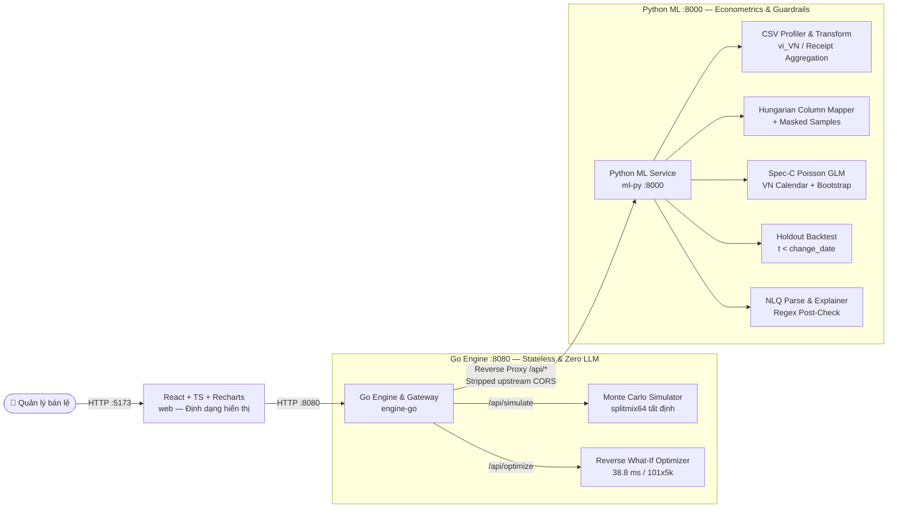

# What-If AI — Nền Tảng Mô Phỏng & Tối Ưu Hóa Quyết Định Kinh Doanh Bán Lẻ

> *"Mô phỏng trước khi quyết định — Hiểu rõ trước khi hành động."*

[](https://www.python.org/)
[](https://fastapi.tiangolo.com/)
[](https://go.dev/)
[](https://react.dev/)
[](LICENSE)
[]()
[-success.svg)]()

---

## 1. Tổng quan & Giá trị Cốt lõi

Trong vận hành bán lẻ SME tại Việt Nam, nhà quản lý thường phải ra quyết định giá và khuyến mãi dựa vào cảm tính hoặc bảng tính nhìn lại quá khứ:
* *Nếu tăng giá bán SKU chủ lực thêm 10% trong 30 ngày tới, lợi nhuận và sản lượng sẽ thay đổi trong khoảng nào?*
* *Nếu khách hàng nhạy giá hơn dự kiến, đâu là ngưỡng độ co giãn hòa vốn (break-even elasticity)?*
* *Mức giá nào giúp đạt mục tiêu lợi nhuận mà vẫn giữ biên lãi tối thiểu và không vượt quá tồn kho?*

**What-If AI** trả lời trực tiếp các câu hỏi phản thực (*counterfactual what-if*) bằng kiến trúc 3 tầng tách bạch tuyệt đối giữa **ngôn ngữ** và **toán học**:

1. **Tầng Kinh tế lượng & NLP (`ml-py`, FastAPI `:8000`)**: Nạp CSV bán hàng lộn xộn (`vi_VN`/`en_US`, đơn vị nghìn đồng, gộp hóa đơn), ánh xạ cột tự động bằng Hungarian assignment, ước lượng **độ co giãn cầu theo giá (Spec-C Poisson GLM + week-block bootstrap)** kiểm soát lịch Tết/ngày đôi Việt Nam, và kiểm định quá khứ (out-of-time backtest).
2. **Tầng Mô phỏng & Tối ưu hóa Tốc độ cao (`engine-go`, Go `:8080`)**: Engine Go stateless sử dụng RNG `splitmix64` tất định để chạy hàng nghìn lượt **Monte Carlo** và quét lưới **Reverse What-If** đa ràng buộc trong ~39 ms, đồng thời làm API Gateway chuyển tiếp an toàn đến `ml-py`.
3. **Tầng Giao diện Tương tác (`web`, React + Vite + Tailwind + Recharts `:5173`)**: Luồng 4 bước trực quan (**Upload → Confirm Columns → Review Assumptions → What-If Simulation**) kèm tab **Reverse What-If** và **Validation**, bắt buộc gắn nhãn nguồn dữ liệu (`SYNTHETIC` | `PUBLIC (M5/DUNNHUMBY)` | `YOUR DATA`) và hiển thị tiền tệ `VNĐ` tách dấu chấm (`1.234.567 ₫`).

---

## 2. Nguyên tắc Kỹ thuật Bất khả xâm phạm (Golden Rules)

* **Zero LLM Math**: LLM *không bao giờ* thực hiện phép tính. LLM chỉ dùng để (a) parse câu hỏi tự nhiên sang JSON chuẩn [`DecisionSpec`](contracts/decision_spec.schema.json), (b) phân giải tên cột mơ hồ, và (c) diễn giải số liệu đã tính — mọi câu trả lời đều đi qua [`verify_explanation_numbers`](ml-py/app/llm/explain.py) để loại bỏ hoàn toàn số bịa (*hallucination*), nếu vi phạm sẽ tự động fallback về template tất định.
* **Khả năng Tái lập Tất định (Determinism)**: Cùng payload + `seed`, kết quả Go trả về giống hệt nhau bất kể `GOMAXPROCS=1` hay `GOMAXPROCS=8+`, đồng nhất với công thức tham chiếu Python trong sai số `< 0.03%` (ngưỡng cho phép `0.5%`).
* **Trung thực Khoa học (Honest Claims)**: Độ co giãn được công bố rõ là **ước lượng quan sát có kiểm soát (controlled observational estimate)**, không phải nhân quả tuyệt đối; mọi cảnh báo `low_price_variation`, `not_significant`, `few_observations`, `positive_elasticity` và danh sách giới hạn ([`docs/LIMITS.md`](docs/LIMITS.md)) đều hiện diện công khai.
* **Bảo mật Dữ liệu**: Dữ liệu upload chỉ lưu trong bộ nhớ phiên làm việc, **không** ghi vào `localStorage` trình duyệt và **không** gửi raw rows ra LLM (tối đa chỉ gửi tiêu đề cột + 5 mẫu đã che số `####`).
* **Minh bạch Nguồn Dữ liệu**: Dữ liệu ngoại tệ như Walmart M5 được quy đổi minh họa theo [`config/fx.json`](config/fx.json) (`25.000 ₫/$`) kèm tooltip ghi chú *"illustrative conversion, not a market rate"*.

---

## 3. Kiến trúc Hệ thống 3 Tầng (3-Tier Architecture)

Chi tiết schema hợp đồng nằm tại [`contracts/`](contracts/) và [`docs/ARCHITECTURE.md`](docs/ARCHITECTURE.md):



---

## 4. Kết quả Kiểm định Thực tế (Verified Benchmarks)

Toàn bộ số liệu dưới đây được trích nguyên văn từ các lần chạy test thực tế trong [`docs/VALIDATION.md`](docs/VALIDATION.md), [`docs/ENGINE.md`](docs/ENGINE.md), và Status Log của các phase:

| Hạng mục Kiểm định | Phạm vi & Bộ dữ liệu | Kết quả Thực tế Đạt được |
|---|---|---|
| **NLP Column Mapping** | 5 biến thể CSV lộn xộn (`vn_headers_vn_numbers`, `erp_abbrev`, thiếu cost/stock, giá nghìn đồng, cấp hóa đơn) | **33 / 33 (100%)** chính xác offline, **0** gán sai với confidence `>= 0.55` |
| **Thu hồi Độ co giãn (Synthetic Spec-C)** | 5 bộ dữ liệu tổng hợp (`starter_4_products`, `fashion_shop_12`, `grocery_fmcg_15`, `electronics_home_10`, `marketplace_large_40`) | MAE **`0.048 – 0.118`** (`<= 0.15`), 90% CI Coverage **`80.0% – 100.0%`**, Spearman `r` lên tới **`0.960 – 1.000`** |
| **Stress Guardrails (Biến động giá thấp / Nhiễu sự kiện)** | `hard_low_price_variation_8` (`sd=0.013`) & `hard_event_confounded_12` (`11.11` / `12.12`) | **8 / 8 (100%)** SKU gắn cờ `low_price_variation`; khử nhiễu `11.11` từ `-5.9` (naive) về `-1.8` (thực `-1.5`) |
| **Historical Out-of-Time Backtest** | 19 sự kiện đổi giá (`t < change_date` -> dự báo 14 ngày holdout) | **18 / 19 (94.7%)** vượt naive baseline, trung bình **88.7%** 80%-interval coverage *(1 ca miss công khai: `grocery_fmcg_15 P04` ngày `11.11`)* |
| **Go Engine & Python Cross-Check** | `BenchmarkOptimizeGrid_100x5000` (101 mức giá × 5.000 sims) & đối chiếu 3 SKU với Python | **`38.8 ms`** / lần tối ưu (505.000 draws); sai lệch P50 Go vs Python **`0.0057% – 0.0219%`** (`<< 0.5%`) |
| **NLQ Parser & Explainer Post-Check** | 45 câu hỏi VN/EN trong [`data/samples/nlq_questions.json`](data/samples/nlq_questions.json) | **30 / 30 (100%)** câu hợp lệ, **15 / 15 (100%)** câu ngoài ngưỡng bị chặn về form nhập tay |

### Minh họa Golden Case (từ [`contracts/golden/golden_proposal.json`](contracts/golden/golden_proposal.json))
Với SKU cơ sở $P_0 = 100.000\text{ ₫}$, Giá vốn $C = 60.000\text{ ₫}$, $Q_0 = 10.000$ sản phẩm/kỳ (Lợi nhuận gộp cơ sở = **400.000.000 ₫**). Khi đề xuất **tăng giá +10%** ($P_1 = 110.000\text{ ₫}$):

| Kịch bản | Độ co giãn ($\varepsilon$) | Sản lượng ($Q_1$) | Lợi nhuận gộp | Độ co giãn hòa vốn ($\varepsilon^*$) |
| :--- | :---: | :---: | :---: | :---: |
| **Cơ sở (Base)** | — | `10.000` | `400.000.000 ₫` | — |
| **Lạc quan** | `-0.5` | `9.534,6` | `476.731.295 ₫` | `-2.3412` |
| **Kỳ vọng** | `-1.0` | `9.090,9` | `454.545.455 ₫` | `-2.3412` |
| **Bi quan** | `-2.0` | `8.264,5` | `413.223.141 ₫` | `-2.3412` |

---

## 5. Hướng dẫn Cài đặt & Khởi chạy (How to Run)

### Cách 1 — Chạy đầy đủ 3 tầng Live (Khuyên dùng khi Demo)

Mở **3 cửa sổ terminal / PowerShell** tại thư mục gốc của repository:

```powershell
# Terminal 1 — Python ML Service (:8000)
cd ml-py
python -m venv .venv
.\.venv\Scripts\Activate.ps1
python -m pip install -e .
python -m uvicorn app.main:app --host 127.0.0.1 --port 8000
```
*(Hệ thống chạy mặc định không cần API key. Nếu muốn dùng LLM ngoài, thiết lập `LLM_PROVIDER="openai"` hoặc `"gemini"` và `LLM_API_KEY` trước khi chạy `uvicorn`.)*

```powershell
# Terminal 2 — Go Simulation Engine & Gateway (:8080)
cd engine-go
go run ./cmd/engine
```

```powershell
# Terminal 3 — React Web Frontend (:5173)
cd web
npm run dev
```

Mở trình duyệt tại **`http://localhost:5173`** (kiểm tra `/health` tại `http://127.0.0.1:8000/health` và `http://localhost:8080/api/health`). Kịch bản demo 3 phút và file mẫu xem tại [`docs/DEMO.md`](docs/DEMO.md).

### Cách 2 — Chạy nhanh 1 Terminal không cần Backend / Wi-Fi (Offline Fixtures)

```powershell
# Windows PowerShell
cd web
$env:VITE_USE_FIXTURES="1"
npm run dev
```
Hoặc chạy `npm run dev` thông thường rồi mở trực tiếp **`http://localhost:5173/?demo=1`**, hoặc bật nút chuyển **Offline Fixtures** ở góc trên bên phải ứng dụng.

---

## 6. Kiểm thử & Xác minh (Verification Commands)

```powershell
# 1. Python ML unit, mapping, elasticity, backtest & NLQ tests (20 passed, 1 skipped do thiếu raw M5)
cd ml-py; python -m pytest -q -rs

# 2. Go static check, race detector & golden simulation tests
cd engine-go; go vet ./...; go test -v -race ./...

# 3. Frontend TypeScript strict build & Vitest component/flow tests (4 passed)
cd web; npm run build; npm test

# 4. E2E Live Full Flow: Upload VN CSV -> Map -> Commit -> Fit -> Simulate -> Optimize -> NLQ + CORS check
python -u e2e/demo_path.py

# 5. Cross-check Go /api/simulate vs công thức tham chiếu Python (ngưỡng <= 0.5%)
python e2e/cross_check_py_go.py
```

---

## 7. Cấu trúc Repository

```
Hackathon_AI_For_Business/
├── AGENTS.md                        # Quy tắc phát triển cho mọi AI Agent & thành viên
├── Makefile                         # Điều phối make data / make test / make dev (Unix)
├── config/fx.json                   # Tỷ giá quy đổi minh họa (USD = 25.000 VND)
├── contracts/                       # JSON schemas & fixtures dùng chung cho 3 tầng
│   ├── fixtures/elasticity_fixture.json
│   └── golden/                      # 4 golden tests (proposal + edge cases)
├── data/
│   ├── synthetic/                   # Bộ sinh dữ liệu v2, lịch VN (vn_calendar.py) & 8 bộ out/
│   ├── public/README.md             # Hướng dẫn tải Kaggle M5 / Dunnhumby (không commit file raw)
│   └── samples/nlq_questions.json   # 45 câu hỏi mẫu gắn nhãn VN/EN cho Phase 6
├── docs/
│   ├── ARCHITECTURE.md              # Đặc tả API & công thức toán học chuẩn
│   ├── DEMO.md                      # Kịch bản bấm demo 3 phút & fallback offline
│   ├── ENGINE.md                    # Kiến trúc Go engine & benchmark
│   ├── LIMITS.md                    # Giới hạn phương pháp luận & phạm vi mô hình
│   ├── NLP_COLUMN_MAPPING.md        # Thiết kế tầng ánh xạ cột tự động
│   ├── ROADMAP.md                   # Kế hoạch thực thi 9 phase cho 2 thành viên
│   └── VALIDATION.md                # Báo cáo thu hồi độ co giãn & backtest thực nghiệm
├── ml-py/                           # 🐍 Python ML Service (:8000)
│   ├── app/
│   │   ├── data/                    # calendar_vn.py, m5_loader.py, dunnhumby_loader.py
│   │   ├── ingest/                  # profile.py, transform.py
│   │   ├── mapping/                 # dictionary.py, scoring.py, assign.py, llm_adjudicator.py
│   │   ├── features/build.py        # Ma trận đặc trưng Spec-C & loại ngày hết hàng
│   │   ├── elasticity/fit.py        # Poisson GLM + HC1 SE + week-block bootstrap
│   │   ├── backtest/run.py          # Holdout backtest lịch sử 14 ngày
│   │   ├── llm/                     # client.py, parse.py, explain.py (post-check zero hallucination)
│   │   ├── schemas/contracts.py     # Pydantic v2 models
│   │   └── main.py                  # FastAPI server
│   └── tests/                       # 6 test suites (contracts, data, mapping, elasticity, backtest, llm)
├── engine-go/                       # 🐹 Go Simulation Engine & Gateway (:8080)
│   ├── cmd/engine/main.go           # HTTP handlers, CORS dedup, reverse proxy -> ml-py
│   └── internal/
│       ├── sim/                     # simulate.go (splitmix64 Monte Carlo, scenarios, break-even)
│       └── optimize/                # grid.go (Reverse What-If có ràng buộc)
├── web/                             # ⚛️ React + TypeScript + Tailwind + Recharts (:5173)
│   └── src/
│       ├── api.ts                   # Client kết nối Go (:8080) & chế độ Offline Fixtures
│       ├── i18n.ts                  # Copy giao diện & hàm formatVND (1.234.567 ₫)
│       ├── components/DataSourceBadge.tsx
│       └── screens/                 # 6 màn hình: Upload, Mapping, Assumptions, WhatIf, Reverse, Validation
├── e2e/                             # Kiểm thử tích hợp 3 tầng (demo_path.py, cross_check_py_go.py)
├── phases/                          # Đặc tả & Status Log chi tiết P0 -> P8
└── slides/                          # Tài liệu thuyết trình & 6 ảnh chụp 1440x1080
    ├── DECK_OUTLINE.md              # Dàn ý 13 slide (<= 25 từ/slide) + 90s speaker notes
    ├── QA_PREP.md                   # 10 câu hỏi phản biện khó (3 câu/ý)
    ├── NOTES.md                     # Checklist nộp bài & storyboard video 2 phút
    └── screens/                     # 01_upload.png .. 06_validation.png
```

---

## 8. Tiến độ 9 Phase (Hackathon Roadmap)

| Phase | Nội dung | Phụ trách | Trạng thái | Tài liệu |
| :---: | :--- | :---: | :---: | :--- |
| **P0** | Foundation & Contracts (Repo skeleton, schemas frozen) | A + B | ✅ Hoàn thành | [`PHASE_0_foundation.md`](phases/PHASE_0_foundation.md) |
| **P1** | Data Layer (Synthetic v2, VN calendar, M5/Dunnhumby loaders) | A | ✅ Hoàn thành | [`PHASE_1_data_layer.md`](phases/PHASE_1_data_layer.md) |
| **P2** | Ingestion & NLP Column Mapping (33/33 offline accuracy) | A | ✅ Hoàn thành | [`PHASE_2_ingestion_mapping.md`](phases/PHASE_2_ingestion_mapping.md) |
| **P3** | Elasticity Engine (Spec-C GLM, bootstrap) & Backtest | A | ✅ Hoàn thành | [`PHASE_3_elasticity_backtest.md`](phases/PHASE_3_elasticity_backtest.md) |
| **P4** | Go Engine (Stateless Monte Carlo + Reverse What-If Grid) | B | ✅ Hoàn thành | [`PHASE_4_go_engine.md`](phases/PHASE_4_go_engine.md) |
| **P5** | React Frontend (6 màn hình, VND edge format, Badges) | B | ✅ Hoàn thành | [`PHASE_5_react_frontend.md`](phases/PHASE_5_react_frontend.md) |
| **P6** | LLM Layer (NLQ Parser + Zero-Hallucination Explainer) | A | ✅ Hoàn thành | [`PHASE_6_llm_layer.md`](phases/PHASE_6_llm_layer.md) |
| **P7** | Integration, Live Wiring, CORS/VN Fix, Demo Freeze | B + A | ✅ Hoàn thành | [`PHASE_7_integration.md`](phases/PHASE_7_integration.md) |
| **P8** | Slides, Q&A Prep & 2-Minute Video Storyboard | A + B | 📝 Draft xong *(chờ nhóm edit & xuất PDF)* | [`PHASE_8_slides_pitch.md`](phases/PHASE_8_slides_pitch.md) |

---

## 9. Giấy phép & Thông tin Nộp bài

* Phát hành theo giấy phép [MIT License](LICENSE).
* **Hackathon AI for Business Innovation 2026**: Nộp PDF (`<= 15` slide tiếng Anh) trước **23:59 ngày 13/11/2026**; Chung kết Pitch ngày **19/11/2026**.
