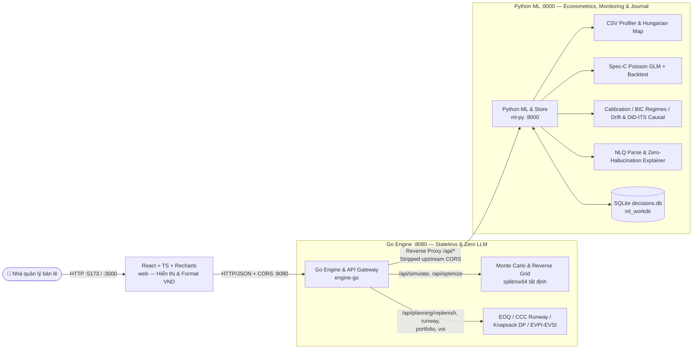

# What-If AI — Nền Tảng Trí Tuệ Quyết Định Kinh Doanh Bán Lẻ (Business Decision Intelligence Platform)

> *"Mô phỏng trước khi quyết định — Kiểm chứng bằng dữ liệu lịch sử — Đối soát kết quả thực tế."*

[](https://www.python.org/)
[](https://fastapi.tiangolo.com/)
[](https://go.dev/)
[](https://react.dev/)
[]()

---

## 1. Tổng quan & Giá trị Cốt lõi

Trong vận hành bán lẻ SME tại Việt Nam, nhà quản lý thường phải ra quyết định giá, khuyến mãi, nhập hàng và dòng tiền dựa vào cảm tính hoặc bảng tính nhìn lại quá khứ:
* *Nếu tăng giá bán SKU chủ lực thêm 10% (hoặc giảm giá theo lộ trình nhiều chặng trước Tết), lợi nhuận và rủi ro biến động nằm trong khoảng nào?*
* *Mức giá nào giúp đạt mục tiêu lợi nhuận mà vẫn giữ biên lãi tối thiểu, ngân sách trợ giá và không vượt tồn kho?*
* *Với dòng tiền và tốc độ bán hiện tại, cần nhập bao nhiêu hàng (EOQ / Safety Stock / ROP), phân bổ vốn cho danh mục đa SKU thế nào, hay có nên chạy thử nghiệm giá (EVPI / EVSI) trước không?*

**What-If AI** trả lời các câu hỏi phản thực (*counterfactual what-if*) và bài toán quyết định kinh doanh bằng kiến trúc 3 tầng tách bạch tuyệt đối giữa **ngôn ngữ** và **toán học**:

1. **Tầng Kinh tế lượng, Giám sát & Lưu trữ (`ml-py`, FastAPI `:8000`)**:
   - Nạp CSV bán hàng thực tế lộn xộn (`vi_VN`/`en_US`, đơn vị nghìn đồng, gộp cấp hóa đơn về ngày), ánh xạ cột tự động bằng thuật toán Hungarian (`scipy.optimize.linear_sum_assignment`).
   - Ước lượng **độ co giãn cầu theo giá (Spec-C Poisson GLM + 300× week-block bootstrap)** kiểm soát Tết âm lịch, siêu sale ngày đôi (`9.9`–`12.12`), kỳ lương và ngày hết hàng.
   - Đánh giá hiệu chỉnh xác suất (`PICP`, `MPIW`, `Pinball`, `WIS`), phát hiện điểm gãy chế độ cầu (**BIC Binary Segmentation**), giám sát trôi mô hình (`PSI`, `KS`, `Durbin-Watson`), đánh giá tác động chuẩn thực nghiệm (**DiD** / **ITS** với sai số **Newey-West HAC**), và lưu vết **Nhật ký Quyết định SQLite** (`workdir/decisions.db`).
2. **Tầng Mô phỏng & Tối ưu hóa Tốc độ cao (`engine-go`, Go `:8080`)**:
   - Engine Go stateless dùng RNG `SplitMix64` tất định để chạy **Monte Carlo 5.000+ lượt**, **Reverse What-If Grid Optimizer**, **Inventory Replenishment (EOQ / ROP / Safety Stock)**, **Working Capital & Cash Runway (DIO/DSO/DPO/CCC)**, **Multi-SKU Portfolio Multiple-Choice Knapsack DP**, và **Value of Information (EVPI/EVSI)**.
   - Đồng thời đóng vai trò **API Gateway** duy nhất cho frontend, tự động strip header CORS trùng từ upstream.
3. **Tầng Giao diện Tương tác (`web`, React 18 + TypeScript + Vite + Tailwind + Recharts `:5173`)**:
   - Giao diện song ngữ **Tiếng Việt | English (`VI | EN`)**, Light/Dark mode, hợp nhất thành **5 workspace chính** (*Mô phỏng What-If + 6 Scenario Templates*, *Tìm giá đạt mục tiêu*, *Kế hoạch Tồn kho / Dòng tiền / Danh mục / EVPI*, *Kiểm chứng mô hình & Drift & Causal*, *Nhật ký Quyết định*) kèm ngăn kéo nạp CSV / ánh xạ cột / chỉnh giả định trực tiếp.
   - Hiển thị tiền tệ `VNĐ` tách dấu chấm (`1.234.567 ₫`) và bắt buộc gắn nhãn nguồn dữ liệu (`SYNTHETIC` | `PUBLIC_M5` | `PUBLIC_DUNNHUMBY` | `YOUR DATA`).

---

## 2. Nguyên tắc Kỹ thuật Bất khả xâm phạm (Golden Rules)

* **Zero LLM Math**: LLM *không bao giờ* thực hiện phép tính. LLM chỉ dùng để (a) parse câu hỏi tự nhiên sang JSON chuẩn [`DecisionSpec`](contracts/decision_spec.schema.json), (b) phân giải tên cột mơ hồ, và (c) diễn giải số liệu đã tính — mọi câu trả lời đều đi qua [`verify_explanation_numbers`](ml-py/app/llm/explain.py) để loại bỏ hoàn toàn số bịa (*hallucination*), nếu vi phạm sẽ tự động fallback về template tất định.
* **Khả năng Tái lập Tất định (Determinism)**: Cùng payload + `seed`, kết quả Go trả về giống hệt nhau bất kể `GOMAXPROCS=1` hay `GOMAXPROCS=8+`, đồng nhất với công thức tham chiếu Python trong sai số `< 0.5%`.
* **Trung thực Khoa học (Honest Claims)**: Độ co giãn được công bố là **ước lượng quan sát có kiểm soát (controlled observational estimate)**, phân tách rõ dữ liệu lịch sử / ước lượng mô hình / giả định người dùng; mọi cảnh báo (`low_price_variation`, `not_significant`, `few_observations`, `positive_elasticity`), ca backtest thua (`grocery_fmcg_15 P04`), và giới hạn cấu trúc ([`docs/LIMITS.md`](docs/LIMITS.md)) đều công khai minh bạch.
* **Bảo mật Dữ liệu**: Dữ liệu upload giữ trong bộ nhớ phiên backend, **không** ghi vào `localStorage` trình duyệt và **không** gửi raw rows ra LLM (tối đa tiêu đề cột + 5 mẫu đã che số `#`).
* **Minh bạch Nguồn Dữ liệu & Tiền tệ**: Dữ liệu ngoại tệ như Walmart M5 được quy đổi minh họa theo [`config/fx.json`](config/fx.json) (`25.000 ₫/$`) kèm chú thích *"illustrative conversion, not a market rate"*.

---

## 3. Kiến trúc Hệ thống 3 Tầng (3-Tier Architecture)

Chi tiết đặc tả đầy đủ nằm tại [`docs/WHATIF_AI_MASTER_GUIDE.md`](docs/WHATIF_AI_MASTER_GUIDE.md), [`docs/DECISION_INTELLIGENCE_AUDIT.md`](docs/DECISION_INTELLIGENCE_AUDIT.md) và [`docs/ARCHITECTURE.md`](docs/ARCHITECTURE.md):



---

## 4. Kết quả Kiểm định Thực tế (Verified Benchmarks)

Số liệu ghi nhận từ [`docs/VALIDATION.md`](docs/VALIDATION.md), [`docs/ENGINE.md`](docs/ENGINE.md) và các lần chạy kiểm thử E2E gần nhất:

| Hạng mục Kiểm định | Phạm vi & Bộ dữ liệu | Kết quả Thực tế Đạt được |
|---|---|---|
| **NLP Column Mapping** | 5 biến thể CSV lộn xộn (`vn_headers_vn_numbers`, `erp_abbrev`, thiếu cost/stock, giá nghìn đồng, cấp hóa đơn) | **33 / 33 (100%)** chính xác offline, **0** gán sai với confidence `>= 0.55` |
| **Thu hồi Độ co giãn (Synthetic Spec-C)** | 5 bộ dữ liệu tổng hợp (`starter_4_products`, `fashion_shop_12`, `grocery_fmcg_15`, `electronics_home_10`, `marketplace_large_40`) | MAE **`0.048 – 0.118`** (`<= 0.15`), 90% CI Coverage **`80.0% – 100.0%`**, Spearman `r` đạt **`0.791 – 1.000`** |
| **Stress Guardrails** | `hard_low_price_variation_8` (`sd=0.013`) & `hard_event_confounded_12` (`11.11` / `12.12`) | **8 / 8 (100%)** SKU gắn cờ `low_price_variation`; khử nhiễu `11.11` từ `-5.9` (naive) về `-1.8` (thực `-1.5`) |
| **Historical Out-of-Time Backtest** | 19 sự kiện đổi giá (`t < change_date` -> dự báo 14 ngày holdout) | **18 / 19 (94.7%)** vượt naive baseline, trung bình **88.7%** 80%-interval coverage *(1 ca miss công khai: `grocery_fmcg_15 P04` ngày `11.11`)* |
| **Go Engine & Python Cross-Check** | `BenchmarkOptimizeGrid_100x5000` (101 mức giá × 5.000 sims) & đối chiếu 3 SKU (`P01`–`P03`) với Python | **`38.8 ms`** / lần tối ưu (505.000 draws); sai lệch P50 Go vs Python **`0.0057% – 0.0219%`** (`<< 0.5%`) |
| **NLQ Parser & Explainer Post-Check** | 45 câu hỏi VN/EN trong [`data/samples/nlq_questions.json`](data/samples/nlq_questions.json) | **30 / 30 (100%)** câu hợp lệ, **15 / 15 (100%)** câu ngoài ngưỡng bị chặn về form nhập tay |

### Minh họa Golden Case (từ [`contracts/golden/golden_proposal.json`](contracts/golden/golden_proposal.json))
Với SKU cơ sở $P_0 = 100.000\text{ ₫}$, Giá vốn $C = 60.000\text{ ₫}$, $Q_0 = 10.000$ sản phẩm/kỳ (Lợi nhuận gộp cơ sở = **400.000.000 ₫**). Khi đề xuất **tăng giá +10%** ($P_1 = 110.000\text{ ₫}$):

| Kịch bản | Độ co giãn ($\varepsilon$) | Sản lượng ($Q_1$) | Lợi nhuận gộp | Độ co giãn hòa vốn ($\varepsilon^*$) |
| :--- | :---: | :---: | :---: | :---: |
| **Cơ sở (Base)** | — | `10.000` | `400.000.000 ₫` | — |
| **Lạc quan** | `-0.5` | `9.534,6` | `476.731.295 ₫` | `-2.3412` |
| **Kỳ vọng** | `-1.0` | `9.090,9` | `454.545.455 ₫` | `-2.3412` |
| **Bi quan** | `-2.0` | `8.264,5` | `413.223.141 ₫` | `-2.3412` |

---

## 5. Hướng dẫn Cài đặt & Khởi chạy (How to Run)

### Cách 1 — Chạy toàn bộ bằng Docker Compose (1 lệnh)

```powershell
# Tùy chọn: sao chép .env.example thành .env nếu muốn cấu hình LLM_API_KEY
copy .env.example .env
docker compose up --build
```
Mở **`http://localhost:5173`** (hoặc `http://localhost:3000`). Dữ liệu Nhật ký Quyết định SQLite được lưu bền vững trong volume `ml_workdir` (`/app/ml-py/workdir/decisions.db`).

### Cách 2 — Chạy Live 3 Terminal tại máy Local

Mở **3 cửa sổ terminal / PowerShell** tại thư mục gốc:

```powershell
# Terminal 1 — Python ML Service (:8000)
cd ml-py
python -m venv .venv
.\.venv\Scripts\Activate.ps1
python -m pip install -e .
python -m uvicorn app.main:app --host 127.0.0.1 --port 8000
```
*(Hệ thống chạy mặc định 100% offline không cần API key. Nếu muốn bật LLM diễn đạt/parse mở rộng, đặt `LLM_PROVIDER` và `LLM_API_KEY` trong `.env`.)*

```powershell
# Terminal 2 — Go Simulation Engine & Gateway (:8080)
cd engine-go
go run ./cmd/engine
```

```powershell
# Terminal 3 — React Web Frontend (:5173)
cd web
npm install
npm run dev
```

Mở **`http://localhost:5173`** (healthcheck tại `http://127.0.0.1:8000/health` và `http://127.0.0.1:8080/api/health`). Kịch bản trình diễn 3 phút xem tại [`docs/DEMO.md`](docs/DEMO.md).

### Cách 3 — Chạy nhanh 1 Terminal không cần Backend (Offline Fixtures)

```powershell
cd web
$env:VITE_USE_FIXTURES="1"
npm run dev
```
Hoặc chạy `npm run dev` thông thường rồi mở **`http://localhost:5173/?demo=1`**, hoặc bật nút chuyển chế độ mẫu trên thanh công cụ ứng dụng.

---

## 6. Kiểm thử & Xác minh (Verification Commands)

```powershell
# 1. Python ML tests (39 tests: contracts, loaders, mapping, elasticity, backtest, NLQ, monitoring, causal, journal)
$env:PYTHONPATH = 'ml-py'; python -m pytest ml-py/tests -q -rs
python -m ruff check --select E9,F63,F7,F82 ml-py e2e

# 2. Go static check, race detector, golden & planning tests (4 packages)
go -C engine-go vet ./...
go -C engine-go test -count=1 -race ./...

# 3. Frontend TypeScript strict build & Vitest suite (4 test files, 17 tests)
npm --prefix web run build
npm --prefix web test -- --run

# 4. E2E Live Full Flow: Upload VN CSV -> Map -> Commit -> Fit -> Simulate -> Optimize -> NLQ + CORS check
python -u e2e/demo_path.py

# 5. Cross-check Go /api/simulate vs công thức tham chiếu Python (ngưỡng <= 0.5%)
python -u e2e/cross_check_py_go.py
```

---

## 7. Cấu trúc Repository

```text
Hackathon_AI_For_Business/
├── AGENTS.md                        # Quy tắc phát triển & Zero LLM Math guardrails
├── Makefile                         # Tiện ích make data / make test / make dev
├── docker-compose.yml               # Triển khai 3 container: ml-py, engine-go, web + ml_workdir
├── .env.example                     # Mẫu biến môi trường (tùy chọn LLM_API_KEY)
├── config/fx.json                   # Tỷ giá quy đổi minh họa (USD = 25.000 VND)
├── contracts/                       # JSON schemas & fixtures dùng chung cho 3 tầng
│   ├── fixtures/elasticity_fixture.json
│   └── golden/                      # 4 golden tests (proposal + edge cases)
├── data/
│   ├── synthetic/                   # Bộ sinh dữ liệu v2, lịch VN (vn_calendar.py) & các bộ out/
│   ├── public/README.md             # Hướng dẫn nạp Kaggle M5 / Dunnhumby (raw CSV nằm ngoài git)
│   └── samples/nlq_questions.json   # 45 câu hỏi mẫu gắn nhãn VN/EN cho kiểm thử NLQ
├── docs/
│   ├── WHATIF_AI_MASTER_GUIDE.md    # Tài liệu tổng hợp đầy đủ tính năng, hạ tầng & thuật toán
│   ├── DECISION_INTELLIGENCE_AUDIT.md # Báo cáo Audit, Gap Analysis 12 tính năng & thiết kế mở rộng
│   ├── ARCHITECTURE.md              # Đặc tả API & công thức toán học chuẩn
│   ├── DEMO.md                      # Kịch bản bấm demo 3 phút & fallback offline
│   ├── ENGINE.md                    # Kiến trúc Go engine & benchmark
│   ├── LIMITS.md                    # Giới hạn phương pháp luận & trung thực khoa học
│   ├── NLP_COLUMN_MAPPING.md        # Thiết kế tầng ánh xạ cột tự động
│   ├── ROADMAP.md                   # Kế hoạch thực thi 9 phase
│   └── VALIDATION.md                # Báo cáo thu hồi độ co giãn & backtest thực nghiệm
├── ml-py/                           # 🐍 Python ML Service (:8000)
│   ├── app/
│   │   ├── data/                    # calendar_vn.py, m5_loader.py, dunnhumby_loader.py
│   │   ├── ingest/                  # profile.py, transform.py
│   │   ├── mapping/                 # dictionary.py, scoring.py, assign.py, llm_adjudicator.py
│   │   ├── features/build.py        # Ma trận đặc trưng Spec-C & loại ngày hết hàng
│   │   ├── elasticity/fit.py        # Poisson GLM + HC1 SE + week-block bootstrap
│   │   ├── backtest/run.py          # Holdout backtest lịch sử 14 ngày
│   │   ├── monitoring/evaluate.py   # Calibration (PICP/MPIW/Pinball/WIS), BIC regimes & PSI/KS/DW drift
│   │   ├── causal/analyze.py        # Difference-in-Differences & Segmented ITS (Newey-West HAC)
│   │   ├── journal/store.py         # Nhật ký Quyết định SQLite (decisions.db)
│   │   ├── llm/                     # client.py, parse.py, explain.py (post-check zero hallucination)
│   │   ├── schemas/contracts.py     # Pydantic v2 contracts
│   │   └── main.py                  # FastAPI server
│   ├── scripts/export_schemas.py    # Script đồng bộ JSON schemas sang contracts/
│   └── tests/                       # 9 test suites Python (unit, API & statistical tests)
├── engine-go/                       # 🐹 Go Simulation Engine & Gateway (:8080)
│   ├── cmd/engine/                  # main.go, main_test.go (handlers, CORS dedup, reverse proxy)
│   └── internal/
│       ├── sim/                     # simulate.go (SplitMix64 Monte Carlo, schedules, break-even)
│       ├── optimize/                # grid.go (Reverse What-If có ràng buộc)
│       └── planning/                # replenish.go, runway.go, portfolio.go, voi.go
├── web/                             # ⚛️ React + TypeScript + Tailwind + Recharts (:5173)
│   └── src/
│       ├── api.ts                   # Client kết nối Go (:8080) & Offline Fixtures
│       ├── i18n.ts                  # Song ngữ VI | EN & định dạng VND (1.234.567 ₫)
│       ├── data/scenarioTemplates.ts # 6 kịch bản mẫu nghiệp vụ
│       ├── components/              # DataSourceBadge, DecisionCharts, StoreHealthPulse, ...
│       └── screens/                 # WhatIf, ReverseWhatIf, Planning, Validation, Journal + Upload/Mapping/Assumptions
├── e2e/                             # Kiểm thử tích hợp 3 tầng (demo_path.py, cross_check_py_go.py)
├── evaluation/                      # Hệ thống chấm điểm đa tác tử black-box (3 persona retail)
├── phases/                          # Đặc tả & Status Log P0 -> P8
└── slides/                          # Dàn ý slide (DECK_OUTLINE.md), Q&A (QA_PREP.md), Notes & screenshots
```

---

## 8. Tiến độ Triển khai & Tài liệu Pitch

| Giai đoạn | Nội dung | Trạng thái | Tài liệu |
| :---: | :--- | :---: | :--- |
| **P0 – P7** | Foundation, Data Layer, Ingestion & Hungarian Mapping, Spec-C GLM & Backtest, Go Engine, React UI, NLQ Guardrails, E2E Integration | ✅ Hoàn thành | [`phases/`](phases/) |
| **Mở rộng DI** | Business Decision Intelligence: EOQ Replenishment, Cash Runway, Portfolio Knapsack DP, EVPI/EVSI, Calibration/Regime/Drift, DiD/ITS Causal, Scenario Templates, SQLite Journal | ✅ Hoàn thành | [`WHATIF_AI_MASTER_GUIDE.md`](docs/WHATIF_AI_MASTER_GUIDE.md) |
| **P8** | Dàn ý 13 slide, 10 câu Q&A phản biện & storyboard video 2 phút | 📝 Sẵn sàng xuất PDF | [`slides/DECK_OUTLINE.md`](slides/DECK_OUTLINE.md) |

---

## 9. Thông tin Nộp bài

* **Hackathon AI for Business Innovation 2026**: Nộp PDF (`<= 15` slide tiếng Anh) trước **23:59 ngày 13/11/2026**; Chung kết Pitch ngày **19/11/2026**.
* Xem hướng dẫn chi tiết nộp bài và video 2 phút tại [`slides/NOTES.md`](slides/NOTES.md).
