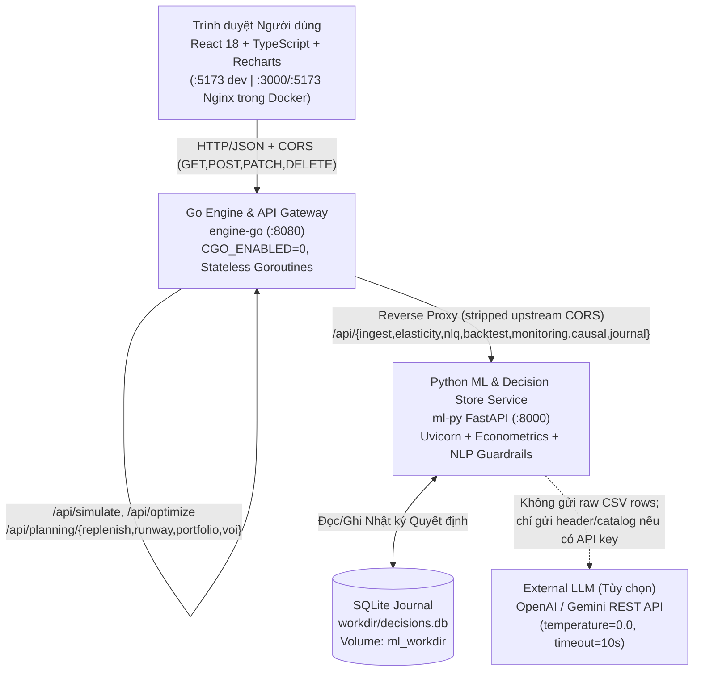

# Tài liệu Tổng hợp Dự án: What-If AI — Nền tảng Trí tuệ Quyết định Kinh doanh Bán lẻ (Business Decision Intelligence Platform)

> *"Mô phỏng trước khi quyết định — Kiểm chứng bằng dữ liệu lịch sử — Đối soát kết quả thực tế."*
> Tài liệu tổng hợp đầy đủ về **tính năng**, **hạ tầng triển khai**, **công nghệ & thuật toán được sử dụng**, **hợp đồng API/Dữ liệu**, và **luồng xử lý End-to-End** của toàn bộ hệ thống **What-If AI**.

---

## 1. Tổng quan Dự án & Triết lý Thiết kế

**What-If AI** giúp chủ cửa hàng và nhà quản lý bán lẻ (đặc biệt SME Việt Nam) chuyển từ ra quyết định giá, nhập hàng và dòng tiền theo cảm tính sang **mô phỏng phản thực (counterfactual)** dựa trên kinh tế lượng, Monte Carlo và tối ưu hóa ràng buộc nguồn lực.

### 4 Nguyên tắc Bất khả xâm phạm
1. **Zero LLM Math (AI ngôn ngữ không bao giờ làm toán)**: LLM chỉ dùng cho 3 việc: (a) parse câu hỏi tự nhiên sang JSON `DecisionSpec`, (b) hỗ trợ chấm điểm tên cột CSV mơ hồ khi điểm tất định chưa rõ, và (c) diễn đạt lời khuyên từ các con số đã được engine Go/Python tính sẵn — sau đó đi qua hậu kiểm [`verify_explanation_numbers`](../ml-py/app/llm/explain.py). Nếu xuất hiện bất kỳ số lạ nào, hệ thống hủy văn bản LLM và dùng template tất định.
2. **Tách bạch Nguồn gốc Dữ liệu (Data Provenance)**: Mọi màn hình planning & mô phỏng phân tách rạch ròi 3 lớp dữ liệu: **Historical Inputs** (dữ liệu lịch sử bán hàng), **Model Estimates** (tham số ước lượng thống kê như $\varepsilon$, $PICP$, $EVPI$), và **User Assumptions** (giả định quản lý như *lead time*, *DSO/DPO*, ngân sách vốn). Không gắn nhãn giả dữ liệu mẫu (`SYNTHETIC` | `PUBLIC_M5` | `PUBLIC_DUNNHUMBY`) thành `USER DATA`.
3. **Tính Tất định & Khả năng Tái lập (Determinism)**: Cùng payload + `seed`, Go engine dùng băm theo chỉ số `SplitMix64` trả về phân phối giống nhau từng bit dù chạy đơn nhân (`GOMAXPROCS=1`) hay đa nhân (`8+`), sai số đối chiếu P50 với công thức Python tham chiếu `< 0.5%`.
4. **Hoạt động Offline & Graceful Fallback**: Toàn bộ quy trình nhập CSV, ánh xạ cột, Spec-C GLM, tối ưu Go, kiểm định drift và giải thích khuyến nghị đều chạy **100% offline** khi không có `LLM_API_KEY`. Giao diện cũng tích hợp sẵn `precomputed_fixtures.json` khi bật Chế độ xem mẫu.

---

## 2. Bản đồ Toàn bộ Tính năng (Hiện hữu + Mở rộng Decision Intelligence)

Hệ thống hợp nhất thành **5 workspace chính** trong [`web/src/App.tsx`](../web/src/App.tsx) (`whatif`, `reverse`, `planning`, `validation`, `journal`) kèm **2 ngăn kéo cấu hình dữ liệu/giả định** (`UploadScreen`, `MappingScreen`, `AssumptionsScreen`):

### A. Nhóm Tính năng Cốt lõi (Core Pricing & Monte Carlo)
| Nhóm tính năng | Chức năng chi tiết | Tầng xử lý |
| :--- | :--- | :--- |
| **Nạp CSV & Ánh xạ cột thông minh** | Đọc CSV giữ nguyên chuỗi thô (`dtype=str`) để bảo toàn dấu chấm nghìn kiểu Việt Nam (`104.000`); hỗ trợ đơn vị nghìn đồng (`K_VND`), `vi_VN` / `en_US`, gộp dòng cấp hóa đơn về ngày; ánh xạ cột bằng thuật toán Hungarian (`linear_sum_assignment`) kèm chế độ xác nhận thủ công | `ml-py` (`ingest/`, `mapping/`) & `web` (`UploadScreen.tsx`, `MappingScreen.tsx`) |
| **Ước lượng Độ co giãn Cầu & Lịch Việt Nam** | Hồi quy **Spec-C Poisson GLM** kiểm soát Tết âm lịch (`pre_far`, `pre_near`, `day`, `post`), ngày đôi (`9.9`, `10.10`, `11.11`, `12.12`), kỳ lương (`payday`), cuối tuần, mùa vụ tuần hoàn, xu hướng và loại ngày hết hàng (`stock == 0`); **300 vòng week-block bootstrap** tạo phân phối `elasticity_samples[]` + cờ cảnh báo trung thực (`low_price_variation`, `not_significant`, `few_observations`, `positive_elasticity`) | `ml-py` (`elasticity/fit.py`, `features/build.py`, `data/calendar_vn.py`) |
| **Mô phỏng What-If (Đơn bước & Lộ trình Đa pha)** | Nhập câu hỏi tự nhiên VN/EN hoặc chỉnh tay đơn bước (`-50%..+100%`, `7–90` ngày) lẫn lộ trình nhiều chặng (VD: 15 ngày đầu giảm 30%, 15 ngày sau tăng dần). Tính 4 kịch bản (`base`, `optimistic P10`, `expected P50`, `pessimistic P90`), histogram **5.000 lượt Monte Carlo**, $P(\text{Lãi} > \text{Gốc})$, **độ co giãn hòa vốn $e^*$**, phân tích thác lợi nhuận (**Waterfall**), đòn bẩy quảng cáo/nhập thêm hàng, **mục tiêu xả kho & thu hồi vốn**, và **6 kịch bản mẫu nhanh (Scenario Templates)** | `engine-go` (`internal/sim/simulate.go`), `ml-py` (`llm/parse.py`, `explain.py`), `web` (`WhatIfScreen.tsx`, `data/scenarioTemplates.ts`) |
| **Tối ưu ngược (Reverse What-If)** | Nhập mục tiêu lợi nhuận kỳ vọng và ràng buộc (*biên lãi tối thiểu*, *trần tồn kho*, *ngân sách trợ giá tối đa*); engine Go quét lưới toàn bộ khoảng giá trong ~39 ms (trên benchmark 101 mức giá × 5.000 sims) để tìm mức giá tối ưu kèm xác suất đạt mục tiêu | `engine-go` (`internal/optimize/grid.go`) & `web` (`ReverseWhatIfScreen.tsx`) |

### B. Nhóm Tính năng Mở rộng (Decision Intelligence Platform)
| # | Tính năng | Chức năng chi tiết & Giá trị nghiệp vụ | Endpoints / Modules |
| :-: | :--- | :--- | :--- |
| **1** | **Inventory Replenishment Optimizer** *(Tối ưu Tồn kho & Nhập hàng)* | Tính **EOQ**, **Safety Stock**, **Reorder Point (ROP)** từ `daily_mean_qty`/`daily_std_qty` lịch sử kết hợp biến động lead time của nhà cung cấp; tính xác suất đứt hàng trong thời gian chờ và tự động phân bổ thứ tự ưu tiên nhập hàng khi bị giới hạn **Ngân sách vốn** hoặc **Sức chứa kho** | `POST /api/planning/replenish` (`engine-go/internal/planning/replenish.go`) + `PlanningScreen.tsx` |
| **2** | **Working Capital & Cash Runway** *(Vốn lưu động & Đường băng Tiền mặt)* | Tính **DIO**, **DSO**, **DPO** và **Chu kỳ chuyển đổi tiền mặt (CCC = DIO + DSO - DPO)**; chạy Monte Carlo song song theo ngày cho **đường băng tiền mặt (`P5`, `P50`, `P95`)** khi có độ trễ công nợ phải thu/phải trả, chi phí cố định hàng tháng và khoản chi nhập hàng, kèm cảnh báo thiếu tiền mặt (`healthy` \| `caution` \| `critical`) | `POST /api/planning/runway` (`engine-go/internal/planning/runway.go`) + `PlanningScreen.tsx` |
| **3** | **Multi-SKU Portfolio Optimization** *(Tối ưu Danh mục Đa SKU)* | Giải bài toán **Multiple-Choice Knapsack Quy hoạch động (DP)** kết hợp **Lagrangian multiplier** cho sức chứa kho, sử dụng trực tiếp hàm `sim.RunSimulation` của Go để đồng thời chọn giá bán & mức nhập hàng cho nhiều SKU nhằm tối đa hóa lợi nhuận điều chỉnh rủi ro ($\mathbb{E}[\Pi] - \lambda(\mathbb{E}[\Pi] - P5)$) | `POST /api/planning/portfolio` (`engine-go/internal/planning/portfolio.go`) + `PlanningScreen.tsx` |
| **6** | **Probabilistic Forecast Calibration** *(Hiệu chỉnh Dự báo Xác suất)* | Chạy walk-forward mở rộng bằng **Poisson/Negative Binomial GLM**; đo **PICP@50/80/90**, **MPIW@80**, **Pinball Loss ($q_{10}, q_{50}, q_{90}$)**, **Weighted Interval Score (WIS)** và vẽ **Reliability Diagram** kiểm tra dải tin cậy có khớp thực tế không | `POST /api/monitoring/evaluate` (`ml-py/app/monitoring/evaluate.py`) + `ValidationScreen.tsx` |
| **7** | **Demand Regime Detection** *(Phát hiện Chế độ Cầu & Điểm gãy)* | Khử mùa vụ ngày cuối tuần rồi chạy **Binary Segmentation theo chuẩn BIC** tìm các điểm gãy cấu trúc (`baseline`, `expansion`, `contraction`, `volatile`) và kiểm định Z-test so sánh độ co giãn nửa đầu so với nửa cuối chuỗi dữ liệu | `POST /api/monitoring/evaluate` (`detect_change_points_bic`) + `ValidationScreen.tsx` |
| **8** | **Model & Assumption Drift Monitor** *(Giám sát Trôi mô hình)* | Giám sát **PSI** & kiểm định **Kolmogorov-Smirnov (KS)** cho phân phối giá/sản lượng, tỷ lệ tăng lỗi dự báo (`error_drift_ratio`), độ lệch trung bình phần dư (`residual_mean_bias_pct`), và thống kê **Durbin-Watson** phát hiện tự tương quan phần dư → gắn cờ `healthy` \| `watch` \| `retrain_recommended` | `POST /api/monitoring/evaluate` + `ValidationScreen.tsx` |
| **5** | **Causal Impact Analysis** *(Đánh giá Tác động Chuẩn thực nghiệm)* | Đánh giá lượng cầu, doanh thu và lợi nhuận gia tăng sau sự kiện giá bằng **Difference-in-Differences (DiD)** (kèm kiểm định xu hướng song song tiền can thiệp $p \ge 0.05$ và phát hiện control SKU bị nhiễm biến động giá/promo) hoặc **Interrupted Time Series (ITS)** với sai số chuẩn **Newey-West HAC**; luôn công bố rõ giả định nhận dạng nhân quả | `POST /api/causal/analyze` (`ml-py/app/causal/analyze.py`) + `ValidationScreen.tsx` |
| **9** | **Value of Information (EVPI & EVSI)** *(Giá trị Thông tin & Thử nghiệm)* | Tính **EVPI** trực tiếp từ 300 mẫu bootstrap độ co giãn (bằng chênh lệch kỳ vọng thông tin hoàn hảo và hành động tối ưu hiện tại) và **EVSI / ENGS** qua cập nhật Bayes liên hợp cho một đợt thử giá A/B nhỏ — trả lời thẳng *"Nên quyết định ngay hay chạy test thực tế trước?"* | `POST /api/planning/voi` (`engine-go/internal/planning/voi.go`) + `PlanningScreen.tsx` |
| **11** | **6 Scenario Templates** *(Kịch bản Nghiệp vụ Chuẩn hóa)* | `flash_sale` (Flash sale 7 ngày), `tet_clearance` (Xả kho cận Tết 14 ngày đa pha), `marketing_expansion` (Đẩy ads +3M đ), `inventory_expansion` (Bổ sung +60 tồn kho), `cash_preservation` (Giữ tiền mặt +8%), `new_product_launch` (Ra mắt giá thâm nhập lộ trình 14 ngày) — nạp thẳng giả định minh bạch vào engine Go | `web/src/data/scenarioTemplates.ts` + `WhatIfScreen.tsx` |
| **12** | **Business Decision Journal** *(Nhật ký & Đối soát Quyết định)* | Lưu mọi kịch bản từ What-If / Reverse What-If vào **SQLite (`decisions.db`)**, theo dõi vòng đời `planned` → `implemented` → `evaluated`, **tự động đối soát kết quả thực tế từ CSV lịch sử** (hoặc nhập tay), tính sai số `profit_variance_vnd` và tỷ lệ thực tế rơi vào dải dự báo $P5$–$P95$ | `GET/POST /api/journal`, `PATCH/DELETE /api/journal/{id}`, `POST /api/journal/{id}/evaluate` (`ml-py/app/journal/store.py`) + `JournalScreen.tsx` |

### C. Ranh giới Trung thực Dữ liệu (#4 & #10)
- **Tối ưu Khuyến mãi (#4)**: Hệ thống **đã hỗ trợ** tối ưu mức giảm giá %, biến kiểm soát khuyến mãi (`promo`), lộ trình giảm/tăng theo từng pha và ngân sách trợ giá. Tuy nhiên các bài toán **Bundle**, **Buy X Get Y (BXGY)**, **Free Shipping** và **Cannibalization giữa các SKU** đòi hỏi dữ liệu cấp hóa đơn (`order_id`), giỏ hàng đồng xuất hiện và biểu phí vận chuyển theo ngưỡng đơn — hiện chưa có trong CSV ngày-SKU chuẩn, nên được **khóa an toàn và thiết kế sẵn blueprint mở rộng** thay vì bịa hệ số thay thế chéo.
- **Tình báo Giá Đối thủ (#10)**: Các bộ CSV SME Việt Nam và chuẩn M5 không chứa chuỗi giá đối thủ theo ngày (ngoại trừ một số file phụ như `retail_price.csv` ở mức tháng chưa map chuẩn). Khi người dùng cung cấp cột `competitor_price_vnd`, pipeline tính năng mới sẽ được kích hoạt sạch mà không giả lập giá thị trường ảo.

---

## 3. Hạ tầng Triển khai & Kiến trúc Hệ thống (Infrastructure Topology)

### 3.1 Sơ đồ Thành phần & Lưu lượng Mạng

### 3.2 Chi tiết Triển khai Container (`docker-compose.yml` & Dockerfiles)

| Service | Base Image / Build | Port | Biến môi trường & Storage | Healthcheck & Bảo mật |
| :--- | :--- | :---: | :--- | :--- |
| **`web`** (`web/Dockerfile`, `web/nginx.conf`) | Multi-stage: `node:20-alpine` (`npm ci && npm run build`) → `nginx:1.27-alpine` | `3000:80`, `5173:80` | `VITE_API_BASE` (`http://localhost:8080`), `VITE_USE_FIXTURES` (`0`), Gzip assets (`expires 7d`), Nginx fallback `/api/` → `engine-go:8080` | `wget -qO- http://127.0.0.1:80/` |
| **`engine-go`** (`engine-go/Dockerfile`) | Multi-stage: `golang:1.22-alpine` (`CGO_ENABLED=0 -trimpath -ldflags="-s -w"`) → `alpine:3.20` non-root `appuser` | `8080:8080` | `PORT=8080`, `ML_URL=http://ml-py:8000` | `wget -qO- http://127.0.0.1:8080/health`; chờ `ml-py` healthy |
| **`ml-py`** (`ml-py/Dockerfile`) | `python:3.12-slim` non-root `appuser`, copy `ml-py/app`, `config/`, `data/synthetic/`, `contracts/` | `8000:8000` | `APP_ENV`, `LLM_PROVIDER`, `LLM_API_KEY` / `GEMINI_API_KEY` / `OPENAI_API_KEY`, `LLM_MODEL`, `LLM_BASE_URL`; volume **`ml_workdir:/app/ml-py/workdir`** chứa `decisions.db` | `urllib.request.urlopen('http://127.0.0.1:8000/health')` |

---

## 4. Thống kê "Cái gì được dùng" (Tech Stack, Libraries & Algorithms)

### 4.1 Tầng Frontend (`web/`)
- **Thư viện lõi (`web/package.json`)**:
  - `react` `^18.2.0` & `react-dom` `^18.2.0` + `typescript` `^5.6.3` (strict mode).
  - `vite` `^5.4.11` & `@vitejs/plugin-react` `^4.2.1` cho build/dev server.
  - `tailwindcss` `^3.4.14`, `postcss`, `autoprefixer` kết hợp hệ thống CSS design tokens (`--paper`, `--surface`, `--ink`, `--accent`, `--cobalt`, `--good`, `--warn`, `--bad`) hỗ trợ **Light/Dark Mode**.
  - `recharts` `^2.12.7` vẽ Fan Charts, Histogram phân phối lãi, Waterfall lợi nhuận, Reliability Curve và biểu đồ DiD/ITS Counterfactual.
  - Bộ test: `vitest` `^2.1.5`, `@testing-library/react` `^16.1.0`, `@testing-library/user-event` `^14.5.2`, `@testing-library/jest-dom` `^6.6.3`, `jsdom` `^25.0.1`.
- **Thiết kế tập trung**: Không dùng Redux hay UI framework cồng kềnh; song ngữ **Tiếng Việt & English** tập trung tại [`web/src/i18n.ts`](../web/src/i18n.ts); định dạng tiền `1.234.567 ₫` qua `formatVND`.

### 4.2 Tầng Go Engine (`engine-go/`)
- **Dependencies**: Chỉ dùng **Go 1.22 Standard Library** (`net/http`, `net/http/httputil`, `math`, `sort`, `sync`, `runtime`, `encoding/json`) — zero dependency ngoài giúp build tĩnh nhanh và nhẹ.
- **Các thuật toán toán học & tối ưu hóa được cài đặt trực tiếp**:
  1. **`SplitMix64` RNG băm theo chỉ số** (`engine-go/internal/sim/simulate.go`) + **Box-Muller normal transform**: Mô phỏng song song bằng worker goroutines mà vẫn tái lập hoàn toàn theo `seed`.
  2. **Bisection Method (50 bước)** & **Closed-form Break-even $e^*$**: Giải phương trình lợi nhuận cân bằng cho cả đổi giá 1 lần và lộ trình nhiều pha.
  3. **Grid Search Multi-Constraint Optimizer** (`engine-go/internal/optimize/grid.go`): Quét lưới giá `[-max..+max]` kiểm tra đồng thời biên lãi, tồn kho và ngân sách trợ giá.
  4. **Acklam Inverse Normal Quantile** (`NormalQuantile`, sai số `< 1.15e-9`) & **Wilson EOQ / ROP / Safety Stock + Priority Margin-per-VND Allocator** (`engine-go/internal/planning/replenish.go`).
  5. **Working Capital CCC & Multi-day AR/AP Lag Monte Carlo Simulator** (`engine-go/internal/planning/runway.go`).
  6. **Multiple-Choice Knapsack Dynamic Programming (250 buckets) + Lagrangian Penalty Search** (`engine-go/internal/planning/portfolio.go`).
  7. **Empirical EVPI & Bayesian Normal-Conjugate Preposterior EVSI / ENGS** (`engine-go/internal/planning/voi.go`).

### 4.3 Tầng Python ML, NLP & Lưu trữ (`ml-py/`)
- **Thư viện lõi (`ml-py/pyproject.toml`)**:
  - `fastapi>=0.110.0`, `uvicorn>=0.28.0`, `pydantic>=2.6.0`, `python-multipart>=0.0.9`.
  - `pandas>=2.2.0`, `numpy>=1.26.0`, `scipy>=1.12.0`, `statsmodels>=0.14.0`.
  - `sqlite3` (Python standard library) cho Decision Journal (`decisions.db`).
  - Dev/Test: `pytest>=8.0.0`, `httpx>=0.27.0`, `ruff>=0.3.0`.
- **Các thuật toán thống kê & AI guardrails được cài đặt**:
  1. **Hungarian Algorithm (`scipy.optimize.linear_sum_assignment`)**: Ánh xạ cột CSV tự động không phân biệt vị trí/tiếng Việt/viết tắt ERP.
  2. **Poisson IRLS GLM (`poisson_irls_fit`) + HC1 Robust Sandwich Variance + 300x Week-Block Bootstrap**: Ước lượng độ co giãn $\varepsilon$ và giữ cấu trúc tự tương quan nội tuần.
  3. **Bracher et al. Weighted Interval Score (WIS)**, **Pinball Loss**, **PICP/MPIW**, **Reliability Quantiles**, và **Negative Binomial Overdispersion Sampling ($\phi$)** (`ml-py/app/monitoring/evaluate.py`).
  4. **Deseasonalized BIC Binary Segmentation** & **Early-vs-Recent Slope Z-test** cho phát hiện Regime/Điểm gãy cầu.
  5. **Population Stability Index (PSI)**, **2-sample Kolmogorov-Smirnov (`scipy.stats.ks_2samp`)**, **Error Drift Ratio**, và **Durbin-Watson** cho phát hiện trôi mô hình.
  6. **Difference-in-Differences (DiD)** với **Pre-Treatment Parallel Trends Test**, **Control Contamination Audit** & **Segmented Interrupted Time Series (ITS)** sử dụng `statsmodels.OLS` với sai số chuẩn **Newey-West HAC** (`ml-py/app/causal/analyze.py`).
  7. **Zero-Hallucination Numeric Post-Check (`verify_explanation_numbers`)** & **Stopword-safe Event-aware Parser** (`ml-py/app/llm/`).

### 4.4 Hợp đồng (Contracts), Dữ liệu & Tỷ giá (`contracts/`, `config/`, `data/`)
- **JSON Schemas & Golden Fixtures**: `contracts/decision_spec.schema.json`, `contracts/elasticity_fixture.schema.json`, `contracts/simulate_request.schema.json`, `contracts/fixtures/elasticity_fixture.json`, và 4 bộ test chuẩn `contracts/golden/*.json`.
- **Tỷ giá tham chiếu minh họa**: [`config/fx.json`](../config/fx.json) (`25.000 ₫/$` — ghi chú *"illustrative conversion, not a market rate"*).
- **Datasets Benchmark (`docs/VALIDATION.md`)**:
  - 5 bộ tổng hợp chuẩn Spec-C: `fashion_shop_12`, `grocery_fmcg_15`, `electronics_home_10`, `marketplace_large_40`, `starter_4_products`.
  - 2 bộ stress test: `hard_event_confounded_12` (khuyến mãi trùng 11.11/12.12), `hard_low_price_variation_8` (`sd(ln P) = 0.013`).
  - Hỗ trợ kiểm chứng dữ liệu công khai Walmart M5 (`PUBLIC_M5`) & Dunnhumby (`PUBLIC_DUNNHUMBY`).

---

## 5. Kết quả Kiểm định đã Ghi nhận (Từ `docs/VALIDATION.md` & `README.md`)

- **Column Mapping trên 5 biến thể CSV lộn xộn**: **33 / 33 (100%)** nhận diện chính xác offline, 0 gán sai khi confidence $\ge 0.55$.
- **Thu hồi Độ co giãn (Spec-C)**: MAE **`0.048 – 0.118`** (`<= 0.15`), 90% CI Coverage **`80.0% – 100.0%`**, Spearman Rank Corr lên tới **`0.960 – 1.000`** (`starter_4_products`, `fashion_shop_12`, `electronics_home_10`).
- **Stress Guardrails**: **8 / 8 (100%)** SKU ít biến động giá kích hoạt cảnh báo `low_price_variation`; trên bộ trùng sự kiện `11.11/12.12`, Spec-C khử nhiễu độ co giãn từ `-5.9` (naive) về `-1.8` (thực `-1.5`).
- **Out-of-Time Historical Backtest**: Thắng mô hình trung bình trượt trên **18 / 19 sự kiện (94.7%)**, độ phủ trung bình khoảng 80% đạt **88.7%** *(1 ca ngoại lệ công khai: `grocery_fmcg_15 P04` ngày `11.11` có WAPE 0.206 vs 0.175 nhưng coverage vẫn đạt 100%)*.
- **Tốc độ Go & Sai số Python**: `BenchmarkOptimizeGrid_100x5000` (505.000 draws) hoàn thành trong **`38.8 ms`**; độ lệch P50 giữa Go và Python từ **`0.0057% – 0.0219%`** (ngưỡng `< 0.5%`).
- **NLQ Guardrails**: **30 / 30 (100%)** câu hợp lệ parse đúng; **15 / 15 (100%)** câu vượt ngưỡng hoặc thiếu SKU bị chặn về form nhập tay.

---

## 6. Danh mục Tài liệu & Điểm Mở rộng Chi tiết

- Đặc tả Kiến trúc & Hợp đồng Core: [`docs/ARCHITECTURE.md`](ARCHITECTURE.md)
- Báo cáo Audit, Gap Analysis 12 Tính năng & Kế hoạch Kỹ thuật: [`docs/DECISION_INTELLIGENCE_AUDIT.md`](DECISION_INTELLIGENCE_AUDIT.md)
- Kết quả Kiểm chứng Kinh tế lượng: [`docs/VALIDATION.md`](VALIDATION.md)
- Ranh giới Phương pháp & Trung thực Khoa học: [`docs/LIMITS.md`](LIMITS.md)
